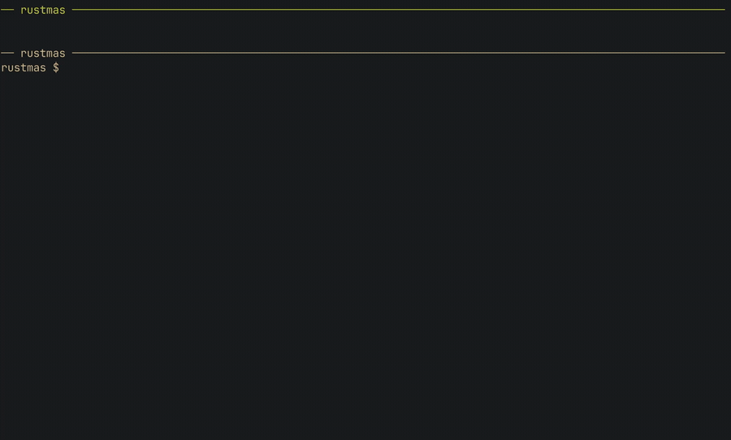

# rustmas

Rust tooling for Advent of Code. It downloads your inputs, runs your solutions, checks the answers against an independent solver, and submits them for stars.

This is Scotty's working branch, with his solutions attached. The `main` branch
is the same tool with no solutions, which is the one to clone if you want a
starting point.



## Quick start

Copy your `session` cookie from [adventofcode.com](https://adventofcode.com) (browser dev tools) into `.env`:

```sh
cp .env.template .env    # paste the cookie into COOKIE=
```

Then run:

```sh
cargo run fetch -y 2015 -d 1              # download one puzzle into cache/
cargo run solve -y 2015 -d 1              # run your solution offline
cargo run solve -y 2015 -d 1 --validate   # check answers against the solver
cargo run solve -y 2015 -d 1 --submit     # check, then send for stars
```

Drop `-y` or `-d` to run all years or days. `--submit` only sends answers the solver agrees with, since wrong ones cost an escalating cooldown. Use `--release` on brute-force days.

## Writing a day

```sh
cp -r src/lib/domain/solution/year_template src/lib/domain/solution/year_2015
```

Each part returns `Answer::solved(value)`, `Answer::Visual(art)`, or `Answer::None`:

```rust
fn part_one(&self) -> anyhow::Result<Answer> {
    Ok(Answer::solved(self.input.len().to_string()))
}
```

Register it with `pub mod year_2015;` in `solution/mod.rs` and an arm in `solver_for` (`src/lib/inbound/solve/mod.rs`), copying the commented example there. Helpers shared across days go in `solution/common/`.

## Reading the output

```
year 2015 day 1 in 12.707µs (3.291µs parsing)
  part one: 138 (correct) [7.125µs]
  part two: 1771 (correct) [2.291µs]
```

| Note | Meaning |
| --- | --- |
| nothing | Solved offline, unchecked |
| `correct` | The solver agrees |
| `high`, `low`, `incorrect` | The solver disagrees, so nothing was submitted |
| `new star` / `starred` | Accepted now / already solved |
| `not logged in` | Cookie missing or expired |
| `unsupported` | The solver can't do this puzzle |
| `rate limited, ...` | Advent of Code refused to grade |
| `(none)` / `(unwritten)` | No answer exists (day 25 part two) / not written yet |
| `error: ...` | The part failed; the other still ran |

Multi-day runs finish with total and average parse and solve times. Timings never include the network.

Re-running `fetch` never re-downloads, and without a cookie `solve` and `--validate` still work offline. More in [`context/`](context/).

## Credits

`--validate` and `--submit` rely on Fredrik Fornwall's [advent-of-code](https://github.com/fornwall/advent-of-code) solver ([API](https://aoc.fornwall.net/api/)). Advent of Code is by [Eric Wastl](https://was.tl/); this tool caches inputs, keeps puzzle text out of git, and identifies itself, per the [about page](https://adventofcode.com/about).

## License

MIT. See [LICENSE](LICENSE).
